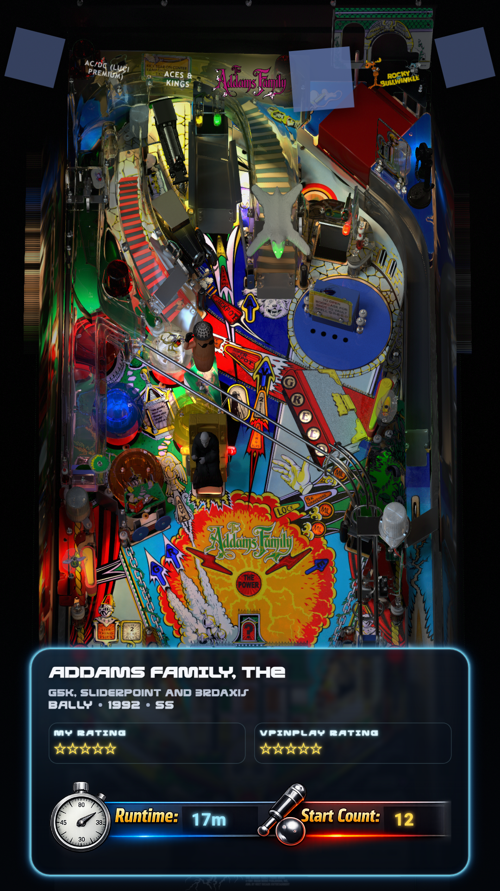

# Trinidad

A cabinet theme. The playfield picture, or its video, fills the screen. An arc of seven
wheels runs across the top with the selected one in the middle, larger and lit. A glowing
panel at the foot names the selected table, its authors, manufacturer, year and type, shows
the player's rating and VPinPlay's, and the table's runtime and start count. A table with no
playfield picture leaves the screen black, and a table with no wheel is named in the arc.



Requires VPinFE 3.0 or later (`min_vpinfe` in `manifest.json`). This is the 3.0 rebuild of
Trinidad, so its version is 2.0.0.

## What is here

```
manifest.json         name, version, author, min_vpinfe and the windows the theme draws
options.json          the options a person can change, with their defaults
index_playfield.html  the playfield page
style.css             the look
theme.js              the behavior
locales/en.json       the theme's own words; add <language>.json to translate them
fonts/                Rocket Command Expanded and Gradient, and Roboto Bold
img/                  the runtime and start count dial, and the collection backdrop
preview.png           shown in the theme list
```

## The two JSON files

JSON cannot carry comments, so what each field does is here.

`manifest.json`

| Field | What it does |
| --- | --- |
| `name`, `version`, `author`, `description` | Shown in the theme list. `version` is the theme's own release number |
| `preview_image` | The screenshot shown in the theme list |
| `type` | `both`: the theme adapts to a desktop screen or a cabinet |
| `min_vpinfe` | The oldest VPinFE that can run the theme |
| `windows` | The pages the theme draws. Trinidad draws `playfield` only, so core's backglass and score view pages are used |
| `change_log` | A string, shown as "What's new" to someone installing or updating the theme |

`options.json` declares what a person can change under the theme's settings. Its `title` and
`description` head the theme's settings page. Each entry has a `key`, a `name` and
`description` the person reads, a `type` and a `default`. The theme reads the value from
`vpin.themeConfig` under the entry's `key`. Trinidad declares one:

| Key | Type | Default | What it does |
| --- | --- | --- | --- |
| `startCollectionSelection` | boolean | `false` | Open the collection picker when the theme starts, instead of the table wheel |

## The four parts of theme.js

`theme.js` has four parts, in this order, each commented:

1. **Options** - read what `options.json` declared from `vpin.themeConfig`.
2. **The wheel** - up to seven pictures on an arc, the selection in the middle. A picture that
   stays on screen when the wheel moves keeps its element, so it glides to its new place. In
   the collection picker the wheel holds the collections' pictures.
3. **The selection** - everything about the selected table is on its entry: the panel's text,
   the stars, the runtime and the start count, and the art. The art is the playfield video
   when the table has one, else its playfield picture, else its full single screen picture.
   A new picture loads behind the old one and fades in over it. In the collection picker the
   panel holds the collection's name, size and kind, and the art is `img/collection_background.png`.
4. **Messages** - hand every message to core, then redraw.

## The page

| Element | What it holds |
| --- | --- |
| `#art` | The playfield picture or video, or the collection backdrop |
| `#wheels` | The arc of wheels |
| `#panel` | The glowing panel |
| `#title`, `#authors`, `#facts` | The table's name, its authors, and its manufacturer, year and type |
| `#my-rating`, `#community-rating` | The player's stars, and VPinPlay's |
| `#runtime`, `#starts` | The two numbers written into the dial picture |
| `#empty` | "No tables found", shown when the list is empty |

The page's outermost element carries `vpinfe-upright`, so core can turn the whole page for a
cabinet screen mounted on its side. The stage is styled by class, not by id, so the rules in
`vpinfe-style.css` that size it for a turned screen still win. Lengths are fractions of the
stage (`cqw`, `cqh`, `cqmin`), so the page keeps its shape on a tall cabinet screen and a wide
desktop one. On a wide screen the panel moves to the bottom right corner.

The playfield picture is stretched to fill the stage. Core
measures it against the screen and turns it a quarter when its shape is the wrong way round.

## What core does, so this theme does not

| Core handles | The theme's part |
| --- | --- |
| Keys, buttons and the remote: stepping, paging, the menu and the collection picker | Launch on `select` |
| Moving the selection and wrapping around the list | Draw the selected table (`activeList().current`) and the wheels around it (`indexAfter`) |
| Serving the table's media | Ask for the playfield video or picture and the wheel by name, and name the table when it has no wheel |
| Audio for the selected table | Nothing |
| Preloading the neighbors | Nothing |
| Turning the page for a sideways cabinet screen | `vpinfe-upright` on the stage, and `applyPlayfieldMediaRotation` on the art |
| The loading indicator while a table starts | Restyle `.vpinfe-launch-spinner` |
| Attract mode | Nothing |
| The backglass and score view pages | Nothing: Trinidad ships none, so core's are used |

## Opt-outs

Trinidad uses none. There is no `config.json`.
