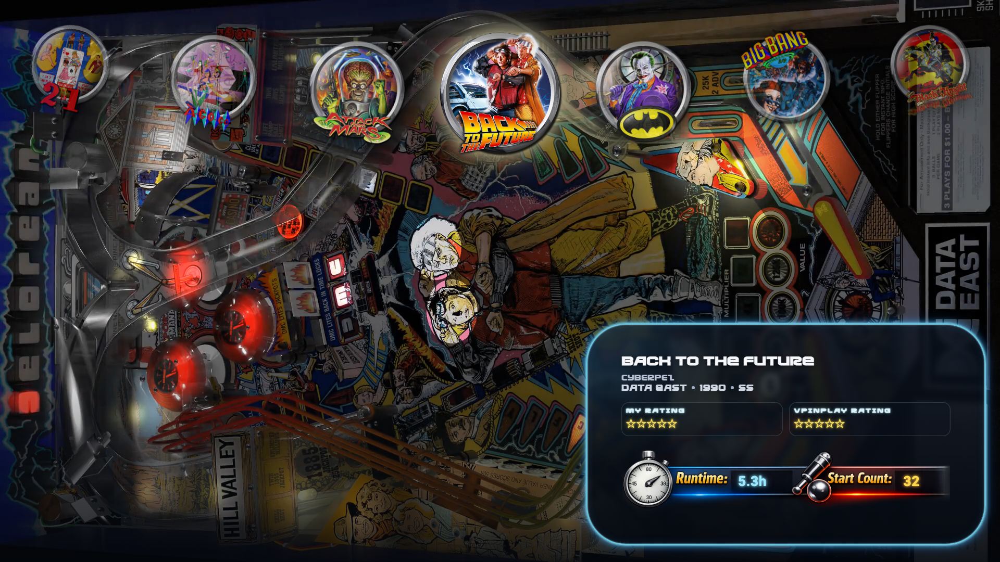

# Trinidad

A theme for a cabinet or a desktop.  The playfield video or picture fills the screen.  An arc of seven wheels runs across the top with the selected one in the middle, larger and lit.  A glowing panel at the foot names the table, its authors, manufacturer, year and type, and shows your rating, VPinPlay's rating, and the table's runtime and start count.

On a wide desktop screen the panel moves to the bottom right corner.

The playfield is the table's video or image, whichever Playfield Media Priority in VPinFE's settings asks for.  A table with neither leaves the screen black, and a table with no wheel is named in the arc.

## Install

Open Themes in the Console, find Trinidad, and press Install.  Then press Make Active and restart VPinFE.  It needs VPinFE 3.0 or later.

## Settings

These are on the Themes page in the Console, under Trinidad's settings.

| Setting | What it does |
| --- | --- |
| Start in Collection Selection | Opens the collection picker as soon as the theme starts.  When it is off, Trinidad starts on the collection set by Open On in VPinFE's settings.  Off by default.  If you set this in VPinFE 2.x, your choice carries over. |
